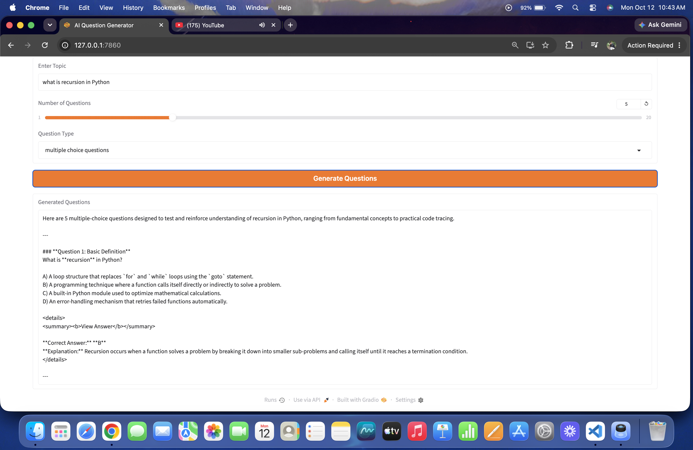

# AI Question Generator

An AI-powered question generator built using Python, Gradio, and the Google Gemini API.

## Features

- Generate questions on any topic
- Select the number of questions
- Choose multiple-choice, short-answer, interview, or long-answer questions
- Generate answers and explanations

## Technologies Used

- Python
- Gradio
- Google Gemini API

## Application Screenshots

Add your screenshots to the `screenshots` folder.



## Installation

Install the required packages:

```bash
pip install -r requirements.txt
```

Create a `.env` file and add your Gemini API key:

GEMINI_API_KEY=your_api_key_here

## Run the Application

```bash
python app.py
```
